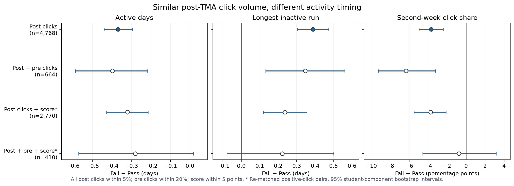

# 行为证据报告：相近点击量下的活动持续性

## 研究问题与口径

首次计分 TMA 截止后两周，**点击总量相近**的学生，其点击分布和最终课程结果是否仍有关联？每个课程批次取首次权重大于零的 TMA 截止日 `d`，观察截止前 `d−13…d` 和截止后 `d+1…d+14`。要求学生在 `d` 前注册、`d+14` 仍在读、作业未承接旧成绩；二分类只含最终 Fail 与 Pass/Distinction。冻结人群为 **19 个课程批次、19,806 条记录**，其中 Fail 6,092 条。[研究协议](TMA_PRIMARY_PROTOCOL.md)

## 从日级事件到配对指标

将 `studentVle` 按学生和相对日期汇总，并把无记录的日期填零。由截止后 14 天序列提取总点击量、**有点击天数**、**最长连续零点击天数**、**第二周点击占比**；截止前点击量用于核查两侧起点。三项时间指标来自同一序列，描述同一个“持续性”现象，不能算作三个独立发现。[特征代码](../oulad-sem/src/tma/daily.py)

在同一课程批次内，将 Fail 与 Pass/Distinction 按截止后点击量相差不超过 **5%** 作 1:1 配对，每条入组记录最多使用一次。主要估计量是选中配对内的 **Fail − Pass/Distinction 均值差**；95% 区间来自固定配对的学生关联组件 bootstrap。主配对为 **4,768 对**，覆盖 78.3% 的 Fail；两侧平均截止后点击分别为 **73.11、73.16**，对数点击标准化差 −0.00034。[匹配代码](../oulad-sem/stages/s06_matching.py)；[平衡表](../oulad-sem/outputs/tables/t06_balance.csv)

## 主结果

| 截止后指标 | Fail − Pass 差值 | 95% 区间 |
|---|---:|---:|
| 有点击天数 | **−0.368 天** | [−0.440, −0.295] |
| 最长连续零点击天数 | **+0.389 天** | [+0.303, +0.473] |
| 第二周点击占比 | **−3.68 个百分点** | [−4.97, −2.41] |

六项冻结主要指标经 Holm 校正，表中三项的校正后 p 值均为 **0.006**。[六项结果](../oulad-sem/outputs/tables/t06_primary_holm.csv) 这支持一个有限但清楚的描述：**点击总量相近时，最终 Fail 一侧把活动集中在更少日期，最长无点击空档更长，第二周份额更低。**

## 稳健性与边界

后段点击容差取 **0%、5%、10%** 时三项方向一致；19 个批次中，有点击天数差值 **19/19 为负**、最长空档差值 **19/19 为正**（第二周占比为 **15/19 为负**）。限制双方后段均有点击后，4,161 对的三项方向仍一致。再要求截止前点击相差不超过 20%，剩 **664 对**，三项区间仍未跨零。[容差表](../oulad-sem/outputs/tables/t06_effects.csv)；[逐批次表](../oulad-sem/outputs/tables/t06_presentation_effects.csv)；[前段敏感性](../oulad-sem/outputs/tables/t06_pre_volume_sensitivity.csv)

主配对并未平衡截止前参与：Fail 一侧平均少约 **20.6 次**前段点击。另在同课程批次内重新配对，要求首次 TMA 分数相差不超过 5 分、后段点击相差不超过 5%，并保留双方后段有点击者，得到 **2,770 对**；有点击天数差 −0.321 天、最长空档差 +0.236 天，区间均未跨零。若进一步要求前段点击相差不超过 20%，只剩 **410 对**：有点击天数差 −0.280 天，区间 [−0.571, +0.017]；最长空档差 +0.222 天，区间 [−0.078, +0.500]；第二周份额差 −0.77 个百分点，区间 [−4.57, +3.16]。三项区间都跨零。成绩配对是**重新配对**，不是主 4,768 对的简单子集；成绩公布日未知，且作业分数参与最终课程成绩，因此这一控制属于回顾性敏感性分析。[成绩配对结果](../results/tma_score_gap_20261103/joint_effects.csv)

提交行为提供背景：主配对中 Fail 一侧 `d+14` 前已提交比例低 **12.35 个百分点**、逾期提交比例高 **8.39 个百分点**；双方都提交的 3,859 对中，提交日平均晚 **1.38 天**。提交与成绩密切相关，不能解释为独立习惯效应。[六项结果](../oulad-sem/outputs/tables/t06_primary_holm.csv)

**结论边界：**现有结果支持选中配对内的条件关联；尚不能确认该差异在成绩与前段参与都相近时仍稳定存在。按最终结局选人不能估计总体失败率或干预效果；固定配对区间未包含重新配对的不确定性，且冻结口径形成于多轮探索之后。图和其 [12 行汇总表](../results/study_story_20261111/paired_persistence_evidence.csv) 可由 [绘图脚本](build_story_evidence_20261111.py) 重建。
