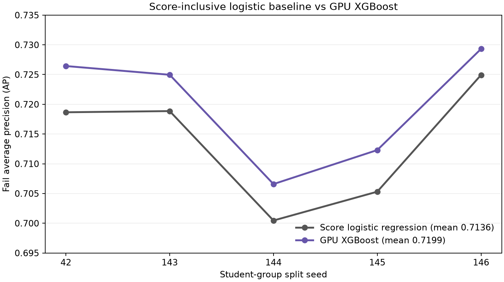

# 建模报告：窗口特征对最终 Fail 的回顾性拟合

## 问题与数据

本线检验首次计分 TMA 前后两周整理出的特征能否对**最终 Fail** 排序，并比较逻辑回归与 XGBoost 对同一批特征的拟合。它使用与[行为报告](BEHAVIOR_REPORT.md)相同的 **19 个课程批次、19,806 条二分类记录**（Fail 6,092）；按学生 ID 分组，避免同一学生进入同次训练与测试。预测性能只说明这批数据上的区分能力，不证明任何单项行为规律。[冻结口径](TMA_PRIMARY_PROTOCOL.md)

## 特征工程与训练

以每批次首次权重大于零的 TMA 截止日 `d` 为锚，取 `d−13…d`、`d+1…d+14`。日级点击先按日期汇总并补零，再构造截止前点击量对数、活跃天数及末三天占比；截止后点击量对数及平方、活跃天数、两周均活跃、最长零点击空档、第二周份额、七天峰值份额、归一化熵和首次活跃日。加入 `d+14` 前提交状态、是否逾期、提前与逾期天数，以及课程批次类别。无分数主模型 **M2** 使用 16 个数值指标；含分数实验另加首次 TMA 分数、分数可用性和手工交互 `未提交 × 最长空档/14`，共 **19 个数值指标 + 19 个课程批次 one-hot 列**。[主特征代码](../oulad-sem/src/tma/daily.py)；[主模型列](../oulad-sem/src/tma/modeling.py)；[含分数输入代码](xgboost_score_20261111/prepare_input.py)

逻辑回归对数值列按外层训练集做中位数填补和标准化。含分数比较在相同五次学生分组 80/20 划分上运行；XGBoost 在每次外层训练集内再按学生分组划出验证集，从三个深度/学习率组合选参数并早停，随后用外层训练集重训。只在 `d+14` 前提交且最终数据中有分数时保留分数；OULAD 没有成绩公布日期，**不能保证当时真实可见**。[训练代码](xgboost_score_20261111/run_xgboost.py)；[实验说明](../results/xgboost_score_20261111/README.md)

## 结果

| 同一五组测试上的模型 | 平均 Fail AP | 平均 ROC-AUC | 平均 Brier |
|---|---:|---:|---:|
| 含分数逻辑回归 | 0.713642 | 0.815161 | 0.149428 |
| GPU XGBoost | **0.719919** | **0.820006** | **0.147897** |
| XGBoost − 逻辑回归 | **+0.006277 AP** | +0.004845 | −0.001531 |

五组 AP 差值均为正，范围 **+0.004380 至 +0.007774**。种子 42 的学生分组 bootstrap 给出该组 ΔAP 95% 区间 **[+0.001432, +0.012403]**。五组测试学生有重叠，不能把 5/5 当作五次独立验证。[逐组指标](../results/xgboost_score_20261111/metrics.csv)；[种子 42 区间](../results/xgboost_score_20261111/interval_seed42.csv)

冻结主流水线中，**不含分数**的 M2 在其单次 60/20/20 主测试上的 AP 为 **0.661077**、Brier 为 **0.164062**，该测试集 Fail 比例为 **0.307809**。[M2 结果](../oulad-sem/outputs/tables/t08_model_metrics.csv) 这与上表的含分数五组实验使用**不同切分和不同特征可用性**，不能把 0.661077 与 0.713642 相减，归因于模型或特征工程改进。若要做**不含分数的同切分对照**，在相同五次学生分组 80/20 划分上用 M2 的 16 个无成绩特征训练 GPU XGBoost，平均 Fail AP 从逻辑回归的 **0.671415** 升至 **0.678759**（**+0.007344**，五组均为正，种子 42 区间 **[+0.00135, +0.01541]**），与含分数臂的提升幅度一致，说明差值主要来自树模型而非成绩字段。[无分数 XGBoost 对照](../results/xgboost_noscore_20261112/README.md)

## 解释与限制

XGBoost 的 gain 排名中，`未提交 × 最长空档`、两周均活跃、活跃天数、TMA 分数及其可用性靠前。[重要性汇总](../results/xgboost_score_20261111/importance_summary.csv) 这些变量相关，gain 不给出效应方向；分数和提交状态也直接区分人群。含分数基线与 XGBoost 都是在反复查看过的 OULAD 测试数据上选择和比较，内部验证的无监督填补/缩放还使用了整个外层训练集的特征分布。因此 **+0.006277 AP 只能作为回顾性探索增益**，不能称为新独立测试上的收益，更不能作为实时预警表现或[行为 finding](BEHAVIOR_REPORT.md)的独立证据。重跑步骤及环境版本见[实验说明](../results/xgboost_score_20261111/README.md)。
