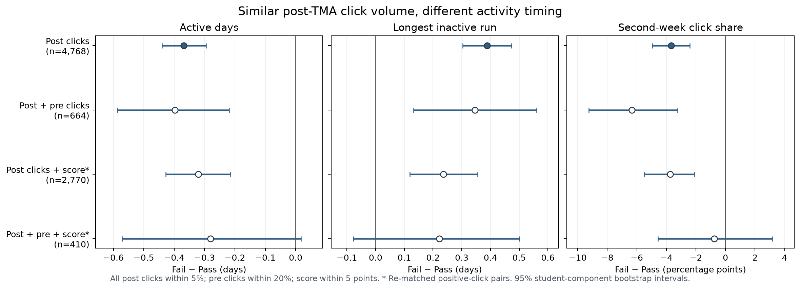

# 相近点击量下，失败学生的后续活动更不连续

这项研究的主问题是：首次计分 TMA 截止后两周，**总点击量相近**的学生，活动分布与最终课程结果是否仍有差异？证据分两条线。**行为线**用同课程批次、相近点击量的配对直接回答问题，是报告主线；**建模线**把同一窗口整理出的特征交给逻辑回归和 XGBoost，检查它们能否对最终 Fail 排序，是辅助结果。模型重要性不能替代配对差值，也不能证明行为差异的方向。

| 线索 | 问题 | 方法 | 可报告的结论 |
|---|---|---|---|
| **行为证据（主线）** | 点击次数相近时，哪些时间与提交行为仍不同？ | 同课程批次、截止后点击量相差不超过 5% 的 Fail/Pass 1:1 配对；报告差值、区间、敏感性 | Fail 一侧点击分布在更少的日期、最长无点击空档更长；严格同时控制成绩与前段点击后证据变弱 |
| **预测拟合（侧线）** | 这些窗口特征能否区分最终 Fail？ | 学生分组测试；含分数逻辑回归与 GPU XGBoost 同一批记录比较 | AP 0.713642 → 0.719919；小幅探索性增益，不能解释成行为规律被证实 |

## 两条线共用一套数据处理

每个课程批次以首次**权重大于零的 TMA** 截止日 `d` 为锚，取 `d−13…d` 和 `d+1…d+14` 两个 14 天窗口。入组要求在 `d` 前注册、`d+14` 仍在读且作业未承接旧成绩；最终二分类只含 Pass/Distinction 与 Fail。由 19 个课程批次得到 19,806 条记录，其中 Fail 6,092 条。[冻结口径](TMA_PRIMARY_PROTOCOL.md)；[特征实现](../oulad-sem/src/tma/daily.py)、[配对实现](../oulad-sem/stages/s06_matching.py)。

日级点击汇总为**后段总量**和**时间形状**：有点击的天数、最长连续零点击天数、第二周点击占比。前段点击和提交状态用于描述起点差异与敏感性检查。这几个时间指标有共同来源，不能当成互相独立的三次发现。模型还使用点击量对数、提交距离、课程批次和手工交互；首次 TMA 分数仅在已提交且有记录分数时保留，成绩公布日未知，因此含分数模型是**回顾性**拟合。最终结果标签没有进入特征构造；它在配对选人和监督模型训练时才使用。

## 主线：同量点击后，持续性仍有差异

主配对有 **4,768 对**，覆盖 78.3% 的 Fail。两侧后段平均点击为 **73.11 与 73.16**，对数点击标准化差约 −0.00034。以下均为**配对内 Fail − Pass/Distinction**；区间来自固定配对的学生关联组件 bootstrap。六项冻结主要指标经过 Holm 校正，以下三项的校正后 p 值均为 0.006。[配对平衡](../oulad-sem/outputs/tables/t06_balance.csv)；[六项校正结果](../oulad-sem/outputs/tables/t06_primary_holm.csv)。

| 后段时间指标 | 差值 | 95% 区间 | 具体含义 |
|---|---:|---:|---|
| 有点击的天数 | **−0.368 天** | [−0.440, −0.295] | 同量点击在 Fail 一侧集中于更少的日期 |
| 最长连续无点击天数 | **+0.389 天** | [+0.303, +0.473] | Fail 一侧出现更长空档 |
| 第二周点击占比 | **−3.68 个百分点** | [−4.97, −2.41] | Fail 一侧的后段点击更偏向第一周 |

方向并非只由某个容差产生：后段点击容差为 0%、5%、10% 时三项均同向；19 个批次中，活跃天数 19/19 为负、最长空档 19/19 为正。只保留双方后段有点击的 4,161 对，三项仍同向。进一步要求前段点击相差 ≤20%，剩 **664 对**，活跃天数 −0.398 天、最长空档 +0.346 天、第二周占比 −6.33 个百分点，三个区间均未跨零。[容差与正点击](../oulad-sem/outputs/tables/t06_effects.csv)；[前段点击敏感性](../oulad-sem/outputs/tables/t06_pre_volume_sensitivity.csv)；[逐批次结果](../oulad-sem/outputs/tables/t06_presentation_effects.csv)。

**更严格的边界同样要报告。**主配对虽然平衡了后段点击，Fail 一侧前段平均点击仍少约 20.6 次，前段对数点击标准化差 −0.287。另做同课程批次、首次 TMA 分数相差 ≤5 分、后段点击相差 ≤5% 的已评分正点击配对，得到 2,770 对：活跃天数 −0.321 天、最长空档 +0.236 天，方向仍一致。再要求前段点击也相差 ≤20%，只剩 **410 对**：活跃天数 −0.280 天 [−0.571, +0.017]，最长空档 +0.222 天 [−0.078, +0.500]，第二周占比 −0.77 个百分点 [−4.57, +3.16]；区间均跨零。两种含成绩配对是重新配对，不是主 4,768 对的简单子集。[成绩配对表](../results/tma_score_gap_20261103/joint_effects.csv)；[平衡表](../results/tma_score_gap_20261103/joint_balance.csv)。因此有证据描述**同量点击下的持续性关联**，但目前不能说它在成绩和前段参与都相近时仍被确认。

提交行为是相关的第二层背景：主配对中 Fail 一侧截至 `d+14` 已提交比例低 12.35 个百分点，逾期提交比例高 8.39 个百分点；仅双方都提交的 3,859 对中，提交日平均晚 1.38 天。作业提交与成绩直接相关，不能把它概括为独立的学习习惯效应。[同一六项主要指标](../oulad-sem/outputs/tables/t06_primary_holm.csv)。

## 侧线：用同一组窗口特征拟合最终结果

主流水线的不含分数逻辑回归 M2 在冻结的学生分组主测试上 Fail AP 为 **0.6611**。另一个**探索性含分数**版本 `S_single_unsubmitted_x_inactive_run`，在五次学生分组 80/20 测试上平均 AP **0.713642**；用相同记录和划分训练 XGBoost，平均 AP **0.719919**，差 **+0.006277**，五组均为正。两者平均 Brier 为 0.149428 与 0.147897。[冻结 M2 指标](../oulad-sem/outputs/tables/t08_model_metrics.csv)；[含分数对照及重跑方法](../results/xgboost_score_20261111/README.md)。M2 的 0.6611 来自不同切分和不同可用特征，不能与 0.713642 相减并归因为模型改进。

这条线的作用是说明整理后的特征包含一定排序信息，且树模型可捕捉少量线性模型之外的结构。XGBoost 的 gain 排名中，“未提交 × 长空档”、两周均活跃、活跃天数、分数与分数可用性靠前，但这些特征高度相关，且“未提交”和“有分数”本身区分了人群。重要性不说明效应方向。含分数基线和 XGBoost 都是在同一份反复查看过的数据上挑选与测试，成绩公布时间又未知；**+0.006277 是回顾性探索增益，不是可部署预警收益，也不是行为主张的独立验证**。

## 最终呈现取舍

正文先用配对图与三项差值讲“点击量相近，时间分布不同”，紧接着给出前段参与和成绩敏感性的边界。模型只用一个小表或现有 [AP 图](../results/xgboost_score_20261111/ap_comparison.png)说明特征可拟合及 XGBoost 的有限增益。聚类、模型家族排行榜、成绩×点击变化交互、资源多样性和“沉默次数”等派生探索留在[结果索引](../results/README.md)，不充当新发现；“最长沉默”与最长无点击空档是同一个指标，不能重复计算证据。这样两条线通过共同特征相连，但各自回答不同问题。

配对按最终结局选人，只能估计选中配对内的条件差异，不能估计总体失败率或干预效果；固定配对区间没有覆盖重新配对的不确定性。冻结协议是在多轮探索后形成的报告口径，学生分组测试也被反复使用。图和汇总表由 [构建脚本](build_story_evidence_20261111.py) 从已提交的聚合表生成；脚本不读取或提交学生级配对记录。
