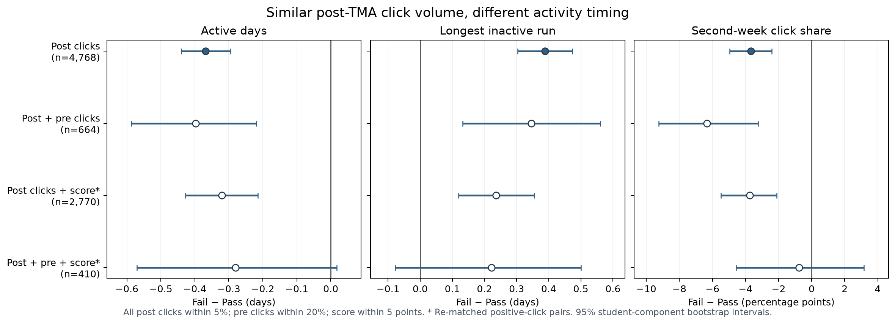

# 配对持续性证据图

本目录的图和 12 行汇总表服务于[两条线研究叙事](../../research/STUDY_STORY_20261111.md)。三个面板分别展示截止后活跃天数、最长无点击空档、第二周点击占比的配对内 **Fail − Pass/Distinction** 差值及 95% 区间。第二周占比以百分点表示。

四行分别来自主配对、加前段点击约束的敏感性、重新进行的成绩配对，以及成绩配对再加前段点击约束。行与行并非同一组配对的连续删减；图用于比较方向与不确定性，不是四个独立检验。最严格的 410 对中三项区间都跨零，报告的写法应是"样本不足以判定"，而不是"效应消失"。

数据来源和每行样本量见 [paired_persistence_evidence.csv](paired_persistence_evidence.csv)。在仓库根目录重建图表：

```bash
python research/build_story_evidence_20261111.py --output-dir results/study_story_20261111
```


