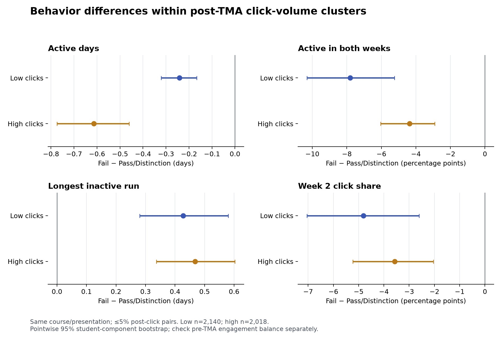

# TMA 后点击量分簇：簇内 P/F 行为比较

这是[前后各两周主分析](../tma_two_week_20261103/README.md)的**事后探索补充**，不是主分析原先预定的检验。原 `tma_two_week.py` 的 3 簇由**时间行为**构建，只在配对样本中观察点击量；它没有按点击量本身分簇。因此本轮新增 `oulad_analysis/tma_click_clusters.py`，先按后段点击量无监督分组，再在每组内查看 P/F 行为差异。

## 点击量簇与比较口径

在 19,806 条最终非退课二分类记录上，单独列出 TMA 后 14 天零点击；其余 17,635 条对 `log1p(post_clicks)` 做一维 K-means。结局标签不参与拟合和簇数选择。k=2–5 中，k=2 的抽样轮廓系数最高（0.583），80% 子样本重拟合平均 ARI 为 0.993；见 `volume_cluster_candidates.csv`。这是一种**点击量分层**，不应暗示存在独立的学习者类型。

| 簇 | 后段点击范围 | 全体二分类记录 | 未匹配 Fail 比例 | 同课程批次、5% 点击配对 |
|---|---:|---:|---:|---:|
| 零点击 | 0 | 2,171 | 70.8% | 607 对 |
| 低点击 | 1–42 | 6,741 | 37.2% | 2,140 对 |
| 高点击 | 43–4,099 | 10,894 | 18.8% | 2,018 对 |

未匹配 Fail 比例仅描述观察到的总体构成，不能解释为点击量的因果作用。簇内比较继续使用已有的同课程、同开课批次、TMA 后点击量相差不超过 5% 的 Fail–Pass/Distinction 配对；4,768 对中 3 对跨越低/高点击分界，排除后为 4,765 对。低点击配对双方平均点击 16.19/16.20，高点击为 155.50/155.61；见 `volume_cluster_balance.csv`。配对按结局组成，因此配对内 P/F 比例人为固定为 1:1，不用于估计失败率。

## 簇内行为差异

差值均为 **Fail − Pass/Distinction**，括号为固定配对下学生关联组件 bootstrap 的探索性 95% 区间。两个正点击簇的主要差值见 `volume_cluster_effects.csv` 和下图。

| TMA 后行为 | 低点击：2,140 对 | 高点击：2,018 对 |
|---|---:|---:|
| 活跃天数 | −0.242 天（−0.321, −0.167） | −0.613 天（−0.774, −0.460） |
| 两周均有活动 | −7.80 个百分点（−10.31, −5.25） | −4.36 个百分点（−6.04, −2.91） |
| 最长连续无点击天数 | +0.428 天（+0.280, +0.580） | +0.468 天（+0.336, +0.603） |
| 第二周点击占比 | −4.81 个百分点（−7.05, −2.60） | −3.57 个百分点（−5.22, −2.04） |



低、高簇中，失败方都更集中在少数日期、无点击间隔更长，且第二周活动占比较低。17 个每簇至少 20 对的课程批次中，活跃天数差的方向分别在低簇 15/17、高簇 16/17 为负；最长空档分别在 16/17、16/17 为正；见 `volume_cluster_presentations.csv`。另把正点击分为三簇，四项主要指标在低、中、高簇方向均一致，见 `three_cluster_sensitivity.csv`。`forumng` 点击份额在两簇的失败方分别低约 1.64 和 2.83 个百分点，但资源结果属于多重探索，不能把资源类别当作学习质量。

**关键限制：TMA 前仍不平衡。** 低簇配对的失败方前段平均点击 68.15、通过方 83.79；高簇为 185.44、210.36；前段对数点击标准化差分别为 −0.282、−0.242。进一步只保留前段点击相差不超过 20% 的配对，低簇剩 269 对、高簇剩 320 对。此时低簇的第二周点击占比差 −12.82 个百分点（−19.13, −6.60），活跃天数差的区间跨 0；高簇的活跃天数差 −0.663 天（−1.000, −0.331），第二周占比差的区间跨 0。最长无点击间隔差在两组仍为正，但区间边界接近 0。见 `volume_cluster_pre_sensitivity.csv`。因此“后段持续性”是可参考的关联模式，尚不能说某一个指标在控制前段参与后对所有点击层都独立、稳定地区分 P/F。

## 复算与边界

先按[两周主分析](../tma_two_week_20261103/README.md#复算)生成 `features.parquet` 和 `post_pairs_05.parquet`，再运行：

```bash
python -m oulad_analysis.tma_click_clusters --input-dir outputs/tma_two_week_20261103 --output-dir outputs/tma_click_clusters_20261103 --seed 42 --repeats 1000
```

输出目录需为空。`volume_cluster_protocol.json` 记录源文件、代码哈希、种子和选择规则；本目录只留汇总表与图。学生级簇标签仅在 Git 忽略的 `outputs/`。聚类和簇内比较是在同一数据集上继续探索，区间未校正多重比较；样本限定到观察截点仍注册且最终非 Withdrawn。结果不能证明改变点击节奏会改变课程结局。
