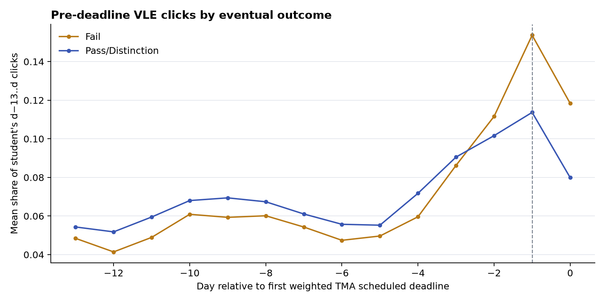

# 首次 TMA 截止前 1／3 天点击爆发与逾期提交

这是[前后两周研究](../tma_two_week_20261103/README.md)、[提交日距离补充](../tma_submission_timing_20261103/README.md)之后的**事后探索**。每个课程批次取首次权重大于零的 TMA，计划截止日记为 `d`。OULAD 只有日期而无当日时间，因此“截止前”新特征严格使用 `d−1` 及更早点击；`d` 当天单列描述。VLE 点击属于课程总体平台活动，不能归因到具体 TMA 题目。

## 特征与样本

从原始 `studentVle.csv` 逐日重建 `d−13…d` 点击，并与现有前段总点击、`d−2…d` 点击完全核对。新增：

- **最后 1 天速率变化**：`log1p(d−1 点击/天) − log1p(d−13…d−2 点击/12 天)`。
- **最后 3 天速率变化**：`log1p(d−3…d−1 点击/3 天) − log1p(d−13…d−4 点击/10 天)`。
- 描述用的最后 1／3 天点击占 `d−13…d−1` 的份额；以及截止当天占 `d−13…d` 的份额。
- 两个速率变化分别与 `submitted_after_due` 相乘，检验其与逾期提交的交互。**逾期二元特征已在原模型里**，这里测试的是新增交互，不把逾期误写成新变量。

全部模型沿用 19,806 条最终 Fail 或 Pass/Distinction、观察至 `d+14` 仍注册的样本。只有 P 系列的输入严格限于 `d−1` 已有的课程批次和点击；这批样本本身仍是事后选出的，**P 系列不能直接当成上线时的真实预警性能**。

## 是否有截止前集中点击

有。对前段有点击的学生，`d−1` 占整个 `d−13…d` 点击的平均份额：最终 Fail **15.37%**，Pass/Distinction **11.37%**；`d−13` 分别为 4.84% 和 5.43%。两组在截止前数日均上升，失败者的相对集中更明显；图与 [`daily_profile.csv`](daily_profile.csv)给出逐日点击、学生平均份额和活跃比例。原始点击量、点击份额、课程背景及最终成绩可混杂这一趋势。



首次 TMA 到 `d+14` 才提交者 1,537 人，失败比例 47.6%；按时提交者 16,284 人，失败比例 23.7%；仍无提交者 1,985 人，失败比例 75.9%。三组前段总点击差异很大；逾期者的平均最后 3 天速率变化为 0.202，按时者为 0.275，不能用粗分层推断“爆发导致逾期”。见 [`overdue_burst_groups.csv`](overdue_burst_groups.csv)。个人批准的延期日期未知。

## 同切分模型消融

五次相同的按学生分组 80/20 测试；基线 `D0` 和 `S0` 的每次 AP/Brier 与[提交日距离实验](../tma_submission_timing_20261103/README.md)完全一致。D 系列已有课程批次、前后点击量、时间行为、提交状态、**逾期**及提交距离；S 系列再加最终记录的首份 TMA 成绩，成绩公布日未知。P 系列只用 `d−1` 可见点击。完整表见 [`models.csv`](models.csv)与[`ap_intervals.csv`](ap_intervals.csv)。

| 模型 | 五次平均 Fail AP | 五次平均 Brier |
|---|---:|---:|
| P0：截止前点击量／活跃天数 | 0.585728 | 0.179180 |
| P0 + 最后 1 天速率变化 | 0.586745 | 0.178990 |
| P0 + 最后 3 天速率变化 | 0.586545 | 0.179027 |
| D0：`d+14` 行为＋提交距离／逾期 | 0.671415 | 0.161560 |
| D0 + 两个短时速率变化 | 0.671171 | 0.161574 |
| D0 + 两个速率变化 × 逾期 | 0.670931 | 0.161624 |
| S0：D0 + TMA 成绩 | 0.706335 | 0.151181 |
| S0 + 两个短时速率变化 | 0.706473 | 0.151188 |

P0 加最后 1 天速率变化的平均 AP 增量约 **+0.0010**，五次方向都为正；种子 42 的学生级 bootstrap 差 +0.00178，探索性 95% 区间 [−0.00043,+0.00431]，跨零。D0 加两项后平均 **−0.00024**；进一步加入逾期交互平均再低约 0.00024。S0 加两项的平均增量仅 **+0.00014**。这些特征可描述临近截止日的集中行为，但当前证据**不支持明显、稳定的额外预测价值**。五次切分重叠，且多轮实验已查看相同数据。

## 相近成绩、点击量与簇内行为

同课程批次、首份 TMA 成绩相差 ≤5 分、截止后两周点击相差 ≤5% 的 **3,098 对**中，Fail 方最后 3 天速率变化平均高 **0.140**，配对组件 bootstrap 探索性区间 [0.075,0.202]。同时 Fail 方逾期比例高 **7.55 个百分点**。进一步要求双方后段有点击且前段点击相差 ≤20%，剩 **410 对**，速率变化差 **+0.253** [0.085,0.428]、逾期差 +5.12 个百分点；双方都按时提交的 **348 对**仍差 **+0.229** [0.049,0.413]。这说明配对差异不全由逾期二元状态解释，但也不能消除准备程度、其他作业或选样偏差。见 [`joint_balance.csv`](joint_balance.csv)与[`joint_effects.csv`](joint_effects.csv)。

沿用已有的结果盲后段点击量簇，高点击簇 1,513 对的速率变化差 +0.212 [0.125,0.294]；低点击簇 1,245 对差 +0.078，区间跨零。再同时限制前段点击和逾期状态，高、低簇各剩 209／137 对，**区间均跨零**；零点击簇样本更少。见 [`volume_cluster_effects.csv`](volume_cluster_effects.csv)。因此不能说此模式在每个点击量簇都独立稳定。

## 复算与边界

先生成两周节点、两周特征和后段点击量簇，再从仓库根目录运行；输出目录须为空：

```bash
python -m oulad_analysis.tma_predeadline_burst --data-dir data/raw --node-dir outputs/assessment_node_2weeks_20261103 --two-week-dir outputs/tma_two_week_20261103_final --cluster-dir outputs/tma_click_clusters_20261103_final --output-dir outputs/tma_predeadline_burst_20261103 --reference-models results/tma_submission_timing_20261103/models.csv --seed 42 --bootstrap 500 --repeats 1000
```

`protocol.json` 留有输入及代码哈希。学生级特征和配对只在 Git 忽略的 `outputs/`，本目录只保存汇总。结果均为关联；平台点击不等于学习时长，TMA 发布日、具体任务、个人延期与成绩公布日不在公开数据中。
