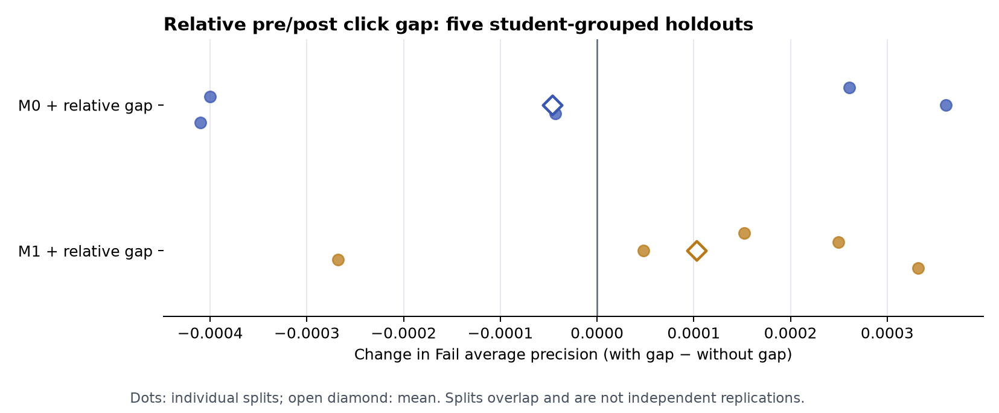

# TMA 前后点击量相对差距：预测增量

这是[前后各两周主实验](../tma_two_week_20261103/README.md)完成后的**事后特征消融**，不改写其冻结协议或已公布的 M0/M1 结果。新增特征为

`relative_click_gap = (post_clicks − pre_clicks) / (post_clicks + pre_clicks)`。

前段 `d−13…d`、后段 `d+1…d+14` 都为 14 天。两段均零点击时设为 0；只在前段有点击为 −1，只在后段有点击为 +1。它有界且对称，便于表示活动重心转移。原 M0/M1 已包含前、后点击量，所以该特征只是**已有信息的非线性表达**，不提供新的观测数据。

在同一 19,806 条最终非退课二分类记录上，使用与原实验完全相同的五次按学生 ID 分组 80/20 划分、训练内标准化与逻辑回归。M0 控制课程批次、前段点击与活跃、临截止点击占比、后段点击量和截点提交；M1 再加入后段时间行为。分别对 M0、M1 添加相对差距，其他特征和测试记录不变。原 M0/M1 的 AP 与 Brier 已逐个划分同先前 `models.csv` 精确核对。

| 模型 | 五次测试平均 Fail AP | 五次测试平均 Brier | 相对原模型的 AP 变化 |
|---|---:|---:|---:|
| 原 M0 | 0.666262 | 0.162761 | — |
| M0 + 相对差距 | 0.666216 | 0.162728 | −0.000046 |
| 原 M1 | 0.668890 | 0.162085 | — |
| M1 + 相对差距 | 0.668993 | 0.162071 | +0.000103 |

M0 加该特征仅 2/5 个划分 AP 上升；M1 加该特征为 4/5 个划分上升，但幅度都非常小。种子 42 的 M1 AP 增量为 +0.000152，学生 bootstrap 探索性 95% 区间 **−0.000427 至 +0.000689**；Brier 变化也接近零，见 `relative_gap_intervals.csv`。下图展示五次划分各自的 AP 差值；划分彼此重叠，不是五次独立复验。



描述性地，Fail 的平均相对差距为 −0.319，Pass/Distinction 为 −0.220，表示前者总体更偏向 TMA 前点击；但该总体差别不能证明它在已有前、后点击量之外仍能提升预测。**当前结论是：加入相对差距可运行，但没有显示有实质意义或可靠的额外预测收益。**本轮已多次探索同一 OULAD 数据，区间不可当作未触碰测试集的确认性证据。

## 复算

先按[两周主实验](../tma_two_week_20261103/README.md#复算)生成 `outputs/<两周目录>/features.parquet`，然后执行：

```bash
python -m oulad_analysis.tma_relative_gap_model --input-dir outputs/tma_two_week_20261103 --output-dir outputs/tma_relative_gap_20261103 --reference-models results/tma_two_week_20261103/models.csv --seed 42 --bootstrap 500
```

输出目录需为空。`relative_gap_protocol.json` 记录公式、模型列、种子和源文件哈希；本目录只保留汇总表与图，不包含学生级预测。
