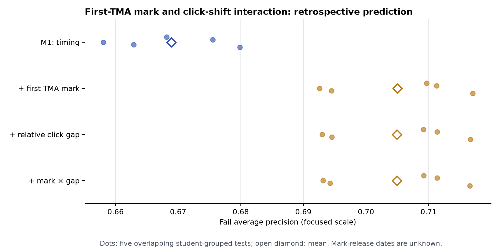

# 首次 TMA 成绩 × 前后两周点击变化：回顾性分析

这是[两周主研究](../tma_two_week_20261103/README.md)和[相对点击差距消融](../tma_relative_gap_20261103/README.md)之后的**事后探索**。OULAD 记录最终作业分数及提交日，**不记录成绩公布日**；因此使用分数的模型只是回顾性解释，不能视为 TMA 截止后第 14 天可部署的实时预测。首次计分 TMA 本身又参与最终课程成绩，分数的预测增益部分是直接、机械的关联。

## 成绩、点击变化与样本

每个课程批次取首次权重大于零的 TMA；仅当学生在 `d+14` 前提交且有最终记录的 0–100 分成绩时，使用该成绩。原两周二分类人群 19,806 条中，**17,816 条有可用成绩**（Fail 4,580；Pass 10,753；Distinction 2,483）。无成绩保留为缺失，模型另设可用性标志；成绩和交互项的缺失值仅按训练集填补。`score_coverage.csv` 列出各结局的提交、成绩覆盖及均分。

前后点击相对差距仍为 `(后段−前段)/(后段+前段)`，两段都零为 0。预测交互项为 `first_tma_score / 100 × relative_click_gap`。描述性“考得低/中/高”采用**同一份 TMA 内**的成绩百分位：后 30%、中间 40%、前 30%；比较基准包含符合截点资格且已记录成绩者，包括最终 Withdrawn。只有 241 条已评分二分类记录低于 40 分，故没有把统一 40 分线当作主要高低分组。成绩百分位仅用于描述和分层，**不进入预测模型**，避免从测试样本构造排名基准。

## 模型增量

五次相同的按学生 ID 分组 80/20 测试，均在原 19,806 条二分类记录上。M1 控制课程批次、前后点击量、前段参与、截止后时间行为和截点提交；其数值与此前实验逐切分核对一致。S0 加成绩和成绩可用性，S1 再加点击相对差距，S2 再加连续分数 × 相对差距交互。见 `models.csv`、`ap_intervals.csv`。

| 模型 | 五次平均 Fail AP | 五次平均 Brier |
|---|---:|---:|
| M1：无成绩 | 0.668890 | 0.162085 |
| M1 + 相对差距 | 0.668993 | 0.162071 |
| S0：M1 + TMA 成绩/可用性 | **0.705011** | 0.151451 |
| S1：S0 + 相对差距 | 0.704951 | **0.151426** |
| S2：S1 + 成绩 × 相对差距 | 0.704915 | 0.151438 |

S0−M1 的 AP 增量在五个切分中为 +0.0316 至 +0.0415；种子 42 的学生 bootstrap 区间为 +0.0298 至 +0.0533。相比之下，S1−S0 的五次平均 AP 差约 −0.00006；S2−S1 约 −0.00004。种子 42 的交互增量仅 +0.000039，区间 **−0.000177 至 +0.000256**。相对差距与成绩交互**没有显示可靠的额外预测价值**。图中的五次切分相互重叠，不是独立复验。



## “考得好/差 × 点击变化”找到什么

在已评分人群中，后段点击比前段大幅减少（相对差距 ≤−0.5，即后段点击不超过前段约三分之一）者，原始失败比例在每个成绩层都较高：低成绩层 **54.4%**，与后段点击增加者的 **39.1%** 相比；高成绩层 **19.1%**，与后段点击增加者的 **10.7%** 相比。详细人数、平均前后点击量和比例见 `score_gap_strata.csv`；公开表只保留至少 30 条记录的格子。这是**未经点击总量平衡的描述**：大幅下降组的后段点击也明显更少，不能据此断定存在成绩与点击变化的独立交互。

进一步在**同课程批次、首次 TMA 成绩相差 ≤5 分、TMA 后点击量相差 ≤5%**的已评分人群中配对，得到 3,098 对，其中双方后段有点击的为 2,770 对。后者的失败方平均后段活跃天数少 **0.321 天**（探索性 95% 区间 −0.427 至 −0.215）；按低/中/高成绩分层分别为 −0.392、−0.247、−0.376 天，三个区间方向一致。相对差距本身在失败方反而平均高 **0.041**（+0.020, +0.061），因为在相似后段点击量和成绩下，失败方**前段点击少约 7.7 次**。这一点说明原始“后段大幅下降＝更易失败”的关系不能当作同量比较的行为解释。见 `joint_balance.csv`、`joint_effects.csv`。

在上述配对中进一步要求**前段点击量也相差 ≤20%**，只剩 410 对。此时相对差距的 P/F 均差约 +0.0002，区间跨零；后段活跃天数仍差 −0.280 天，但区间 **−0.571 至 +0.017** 也跨零。最值得继续复验的候选属性是**同成绩、同后段点击量下的后续活动持续性**；现有前段同时平衡的子集尚不足以确认它是稳定的独立信号。

## 复算

先按两周主研究生成 `node_features.parquet` 和 `features.parquet`，再运行：

```bash
python -m oulad_analysis.tma_score_gap --data-dir data/raw --node-dir outputs/assessment_node_2weeks_20261103 --two-week-dir outputs/tma_two_week_20261103 --output-dir outputs/tma_score_gap_20261103 --reference-models results/tma_relative_gap_20261103/relative_gap_models.csv --seed 42 --bootstrap 500 --repeats 1000
```

输出目录需为空。`protocol.json` 记录窗口、定义、模型列、源文件及代码哈希。学生级配对只保存于 Git 忽略的 `outputs/`；本目录仅为汇总表和图。多个事后比较、已查看测试集、成绩公布日未知与最终非退课样本选择均限制解释，所有结论是关联而非干预效果。
