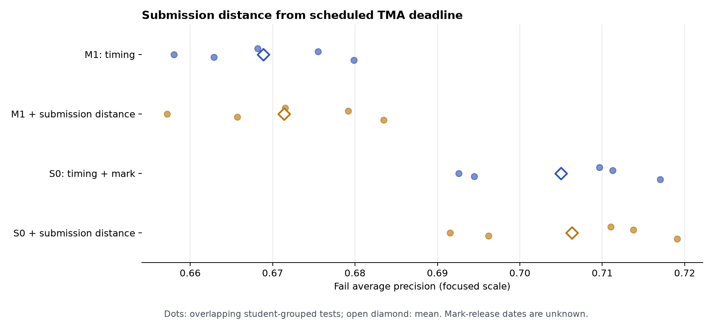

# 首次 TMA 提交日距截止日：两周窗口补充分析

OULAD 原论文把 **TMA（Tutor Marked Assessment，导师批改的考核）**、CMA（计算机批改的考核）及期末 Exam 分列。TMA 可按课程作业型考核研究，但公开表没有题目、提交文件或具体形式，不能断言每份都是论文、习题或在线测验。[数据集论文](https://pmc.ncbi.nlm.nih.gov/articles/PMC5704676/)

本实验接续[两周主分析](../tma_two_week_20261103/README.md)及[成绩分析](../tma_score_gap_20261103/README.md)，是查看前述结果之后的**探索性补充**。同课程批次取首次权重大于零的 TMA，以 `assessments.date` 为统一计划截止日 `d`；`studentAssessment.date_submitted` 是提交日。只使用 `d+14` 当日或以前的提交。`days_early=max(d−提交日,0)`、`days_late=max(提交日−d,0)`；截止后两周仍未提交者两者均缺失，原有 `submitted_by_cutoff` 指示其状态。原 M1 已包含是否在截止后提交，因此新增的是**距离的连续信息**。

## 描述性分层

二分类样本 19,806 条。详见 [`submission_bands.csv`](submission_bands.csv)。

| 提交相对截止日 | 人数 | Fail 比例 |
|---|---:|---:|
| 提前至少 7 天 | 1,510 | 15.9% |
| 提前 1–6 天 | 10,427 | 19.7% |
| 截止当天 | 4,347 | 35.8% |
| 晚 1–7 天 | 1,175 | 48.1% |
| 晚 8–14 天 | 362 | 45.9% |
| 到 `d+14` 仍无提交 | 1,985 | 75.9% |

这些是原始比例，不能解释为提前提交的因果效果。提交较早者的 TMA 成绩及前后点击量也较高；个人获准延期日期不在数据中。

## 同切分预测消融

沿用五次按学生 ID 分组的 80/20 划分，仍在全部 19,806 条记录上训练。M1 控制课程批次、前后点击量、时间行为、是否提交及是否逾期；S0 在 M1 上加入已记录的首次 TMA 成绩及其可用性。两种基线的每次 AP/Brier 均与[既有成绩实验](../tma_score_gap_20261103/README.md)逐切分一致。新增两列是提前天数和逾期天数。

| 模型 | 五次平均 Fail AP | 五次平均 Brier |
|---|---:|---:|
| M1 | 0.668890 | 0.162085 |
| M1 + 提交距离 | 0.671415 | 0.161560 |
| S0：M1 + 成绩 | 0.705011 | 0.151451 |
| S0 + 提交距离 | 0.706335 | 0.151181 |

种子 42 的学生级 bootstrap：M1 加距离的 AP 差 +0.00337，95% 区间 [+0.00077,+0.00584]；S0 加距离为 +0.00137，区间 [−0.00085,+0.00383]。五次切分有重叠，不是独立复验；S0 增量的区间跨零。成绩公布日未知，含成绩的 S0 仅用于**回顾性**分析，不能当作 `d+14` 可用的实时模型。见 [`models.csv`](models.csv)、[`ap_intervals.csv`](ap_intervals.csv)及图。



## 相近成绩及后段点击量的配对

在同课程批次、首次 TMA 成绩相差不超过 5 分、截止后两周点击量相差不超过 5% 的已评分学生中，得到 **3,098 对**。失败方的平均提交相对日为 `d−0.74`，通过方为 `d−1.71`，即失败方晚约 **0.96 天**；按配对连通分量 bootstrap 的探索性 95% 区间 [0.78,1.15] 天。两方后段均有点击的 2,770 对差约 1.02 天。再要求前段点击量相差不超过 20%，仅剩 **410 对**，差为 **0.91 天**，区间 [0.37,1.42] 天。[`joint_balance.csv`](joint_balance.csv)、[`joint_effects.csv`](joint_effects.csv)给出平衡和分项差值。

配对限制了可见的成绩与点击量差异，但仍可能有未测量的准备程度、课程安排及延期差异；对最终 P/F 选样和重复探索也会影响解释。此结果支持把**提交相对截止日**列为可复验的行为属性，不支持“提前提交会提高通过率”的因果结论。

沿用[既有结果盲后段点击量簇](../tma_click_clusters_20261103/README.md)再分层：零点击簇 328 对，提交日差 +0.52 天，区间 [−0.05,1.14]；低点击簇 1,245 对，差 **+0.92 天** [0.61,1.20]；高点击簇 1,513 对，差 **+1.09 天** [0.81,1.40]。12 对跨簇边界而排除。进一步限制前段点击量差不超过 20% 时，低簇 161 对差 +0.86 天 [0.04,1.70]，高簇 246 对差 +0.92 天 [0.31,1.56]；零点击簇仅 32 对，区间跨零。见 [`volume_cluster_effects.csv`](volume_cluster_effects.csv)。这些簇由同一数据集拟合并经多轮筛查，区间未校正多重比较。

## 复算

先生成两周节点和学生级特征，再从仓库根目录运行：

```bash
python -m oulad_analysis.tma_submission_timing --data-dir data/raw --node-dir outputs/assessment_node_2weeks_20261103 --two-week-dir outputs/tma_two_week_20261103_final --cluster-dir outputs/tma_click_clusters_20261103_final --output-dir outputs/tma_submission_timing_20261103 --reference-models results/tma_score_gap_20261103/models.csv --seed 42 --bootstrap 500 --repeats 1000
```

输出目录必须为空。`protocol.json` 记录输入及代码哈希。学生级配对仅存于 Git 忽略的 `outputs/`；本目录保留汇总证据。
