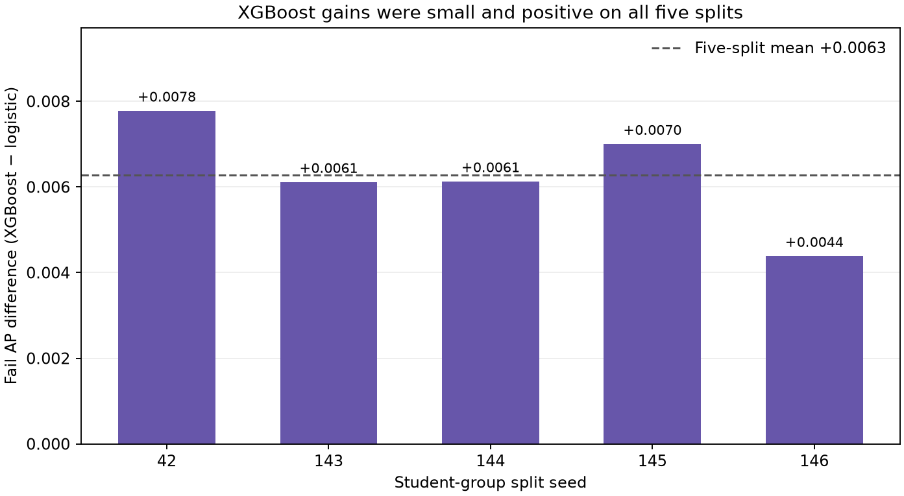

# XGBoost 与含分数逻辑回归的对照（探索性）

本实验是[两条线研究叙事](../../research/STUDY_STORY_20261111.md)中的**回顾性建模侧线**。它从融合版 `feat/oulad-sem-tma` 的提交 `c761727` 出发，比较已有的 `S_single_unsubmitted_x_inactive_run` 逻辑回归与 GPU XGBoost。正类为最终 `Fail`。两者使用相同的 19,806 条二分类记录、同一批 19 个课程呈现和五组按学生 ID 分组的 80/20 训练/测试划分。原逻辑回归五组 AP 在输入准备阶段逐一精确复现；模型差异不是配对行为 finding 的证据。

## 结果

| 随机种子 | 逻辑回归 Fail AP | XGBoost Fail AP | ΔAP |
|---:|---:|---:|---:|
| 42 | 0.718657 | 0.726432 | +0.007774 |
| 143 | 0.718857 | 0.724965 | +0.006107 |
| 144 | 0.700458 | 0.706583 | +0.006125 |
| 145 | 0.705305 | 0.712302 | +0.006997 |
| 146 | 0.724931 | 0.729311 | +0.004380 |
| **平均** | **0.713642** | **0.719919** | **+0.006277** |

五组平均 ROC-AUC：逻辑回归 0.815161，XGBoost 0.820006；五组平均 Brier：0.149428 与 0.147897。详细数值、内部验证 AP、参数和轮数见 [metrics.csv](metrics.csv)。种子 42 的学生分组 bootstrap（400 次）给出 ΔAP 95% 区间 **[+0.001432, +0.012403]**，见 [interval_seed42.csv](interval_seed42.csv)。五组测试集彼此重叠，`5/5` 提升不能当作五次独立显著性检验。



## 特征与训练

输入包含 19 个数值特征和 19 个课程呈现 one-hot 列。数值特征包括截止前后点击量的对数与平方项、活跃天数、最长无点击空档、第二周点击占比、活动熵、提交提前/逾期天数、首次 TMA 分数、分数可用性和 `未提交 × 最长无点击空档`。`features_scores.parquet` 中的原始最终分数必须在准备时遮蔽：只有截至首次计分 TMA 截止后 `d+14` 已提交且有记录分数的记录才保留分数。缺失分数在每组外层训练集用中位数填补，数值列也只用该训练集标准化。

XGBoost 使用 CUDA `hist` 树；在每组外层训练集中再按学生分组留出 20% 内部验证。从 `(max_depth, learning_rate)=(3,.03),(5,.03),(3,.05)` 中按 scikit-learn AP 选择，最多 400 轮，以 `aucpr` 早停 35 轮；选定轮数后用整个外层训练集重新训练。`subsample=.85`、`colsample_bytree=.85`、`reg_lambda=1`。输入预处理在整个外层训练集拟合，因此内部验证的无监督填补/缩放使用了该验证集的特征分布；标签没有进入这些步骤。外层测试集没有用于拟合或参数选择。设备检查要求实际训练器报告 `cuda:0`。

[importance_by_seed.csv](importance_by_seed.csv) 与 [importance_summary.csv](importance_summary.csv) 给出五组模型的 gain 重要性。均值较高的是 `未提交 × 最长无点击空档`、截止后两周均活跃、截止后活跃天数、首次 TMA 分数和分数可用性；其中“两周均活跃”的重要性在五组间波动较大。重要性反映模型在当前数据上的分裂贡献，不表示关联方向或因果作用；相关特征的重要性会相互分摊。模型 AP 的提高也不能独自证明特定的点击集中/空档行为规律。

## 重跑

从仓库根目录安装原项目依赖，再安装本实验单独的 [requirements.txt](../../research/xgboost_score_20261111/requirements.txt)。先按仓库主流程生成 `oulad-sem/data/processed/features.parquet` 和 `features_scores.parquet`。以下命令生成**学生级**临时 NPZ，默认放在 Git 忽略的 `outputs/`；若在另一台 GPU 机器训练，只传输该 NPZ，不提交到 Git。

```bash
python -m pip install -r requirements.txt
python -m pip install -r research/xgboost_score_20261111/requirements.txt
python research/xgboost_score_20261111/prepare_input.py --output outputs/xgboost_score_input.npz
python research/xgboost_score_20261111/run_xgboost.py --input outputs/xgboost_score_input.npz --output-dir outputs/xgboost_score_run
python research/xgboost_score_20261111/plot_results.py --metrics outputs/xgboost_score_run/metrics.csv --output outputs/xgboost_score_run/ap_comparison.png
```

本次实际运行：Windows Python 3.12.10、XGBoost 3.4.1、scikit-learn 1.9.1、NumPy 2.4.2、RTX 3050 6 GB，见 [provenance.json](provenance.json)。训练脚本在 [research/xgboost_score_20261111](../../research/xgboost_score_20261111/)；提交的 `results/` 仅含汇总指标、重要性和图，不含学生级预测或特征矩阵。

## 解释边界

本基线本身是查看过同一数据后选出的探索性版本；这批测试记录也已被多轮模型实验复用，因此 +0.006277 AP 属于探索性估计，不是新独立测试集上的确认。OULAD 未提供分数公布时间，故分数虽在提交截止状态上遮蔽，仍不能保证 `d+14` 时真实可见；结果应称为**回顾性含分数比较**，不能作为当时可部署的预警指标。
